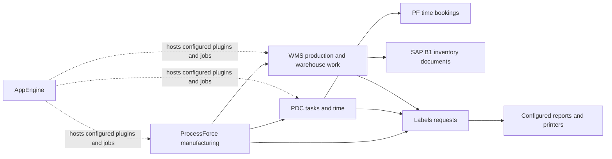

# CompuTec Addon Knowledge Base

This reference explains the roles, core workflows, integrations, and reporting implications of the five CompuTec products used here. Product usage and all five installed versions below are user-confirmed on **2026-10-15**. Vendor behavior is summarized from [CompuTec Learn](https://learn.computec.one/), reviewed on that date. Enabled company settings remain unconfirmed.

Use the environment facts in [AGENTS.md](../../AGENTS.md) alongside these vendor references. A documented capability does not mean it is enabled in `CONTAMAC_LIVE`. These are concise working guides with links for deeper procedures, rather than an offline copy of every vendor article.

## Product guides

| Product | Role | Local guide |
| --- | --- | --- |
| ProcessForce | Manufacturing definitions, MORs, execution, costing, quality, traceability | [ProcessForce](processforce.md) |
| WMS | Warehouse transactions, scanning, bins, batches, and storage units | [WMS](wms.md) |
| PDC | Shop-floor tasks, time, quantities, and downtime | [PDC](pdc.md) |
| Labels | Request-driven label/report selection, generation, and printing | [Labels](labels.md) |
| AppEngine | Plugin hosting, company assignments, APIs, and background jobs | [AppEngine](appengine.md) |

Product roles follow the [vendor product directory](https://learn.computec.one/). Details and configuration conditions are cited in each guide.

## How the products connect

This is a functional map, not a diagram of the installed servers or a guarantee that every connection is configured:

The product guides explain version-dependent hosting and the distinction between requesting an action and its completion. See [PDC](pdc.md), [WMS](wms.md), [Labels](labels.md), and [AppEngine](appengine.md) for the supporting vendor sources.

## Versions and applicability

| Product | User-confirmed installed version |
| --- | --- |
| ProcessForce | 10.0, build **10.0.20.15**, Release **20 HF 2**, **64-bit** |
| WMS | **2.10.20.10** |
| PDC | **3.10.18.2** |
| Labels | **4.7.1.117** |
| AppEngine | **2.10.11.5** |

The [ProcessForce 2.0 release listing](https://learn.computec.one/docs/processforce/2.0/releases/download/) explicitly includes 10.0.20.15 R20 HF2. Prefer [ProcessForce 2.0](https://learn.computec.one/docs/processforce/2.0/) and [AppEngine 2.0](https://learn.computec.one/docs/appengine/2.0/) for this installation. PDC 3.10.18.2 appears in the [AppEngine 2.0 PDC release table](https://learn.computec.one/pl/docs/appengine/2.0/releases/plugins/pdc/download/); its leading 3 does not identify the AppEngine generation. Labels articles with minimum builds later than 4.7.1.117 describe features outside the confirmed installation.

The ProcessForce/WMS hosting arrows above describe a version-dependent architecture; newer 3.0 deployment instructions are not the current environment baseline.

| Documentation reviewed | Scope to keep separate |
| --- | --- |
| ProcessForce 3.0; selected 2.0 time-booking/API and legacy 10.0 MRP references | The 3.0 edition is managed through AppEngine 3.0. Do not treat legacy examples as universal 3.0 instructions. |
| WMS operational pages marked 2.0; installation guide marked 3.0 | The newer installation includes AppEngine plugins and background jobs. |
| PDC pages marked 3.0 | Check actual PDC build and compatible ProcessForce/AppEngine components. |
| Labels documentation marked 1.00 | This is a documentation selector label, not proof of an installed software build. Some articles specify separate minimum builds. |
| AppEngine 3.0 with a separate 2.0 documentation branch | The 3.0 runtime uses .NET 8; 2.0 uses .NET Framework. |

Version distinctions are described in the [ProcessForce introduction](https://learn.computec.one/docs/processforce/), [WMS installation guide](https://learn.computec.one/docs/wms/administrator-guide/installation/overview/), [PDC introduction](https://learn.computec.one/docs/pdc/), [Labels introduction](https://learn.computec.one/docs/labels/), and [AppEngine introduction](https://learn.computec.one/docs/appengine/). Confirm versions before applying installation or configuration instructions.

## Applying this to repository queries

1. Define the business event and result grain: MOR, task, booking document, booking line, inventory line, or print request.
2. Select the product guide, then verify every physical identifier in KB05/PF02. Vendor UI labels and semantic-view columns are not automatically physical table columns.
3. Use KB07/KB08 descriptions and values, KB09/PF05 membership, and KB10/PF03 keys. KB11/PF04 returned no foreign keys, so validate application joins and row counts explicitly.
4. Define cancellation, correction, status, date, and UoM handling before calculating totals. Avoid joining employee or allocation detail directly into resource costs unless aggregated to the required grain.
5. Reconcile a known example in the relevant application. Treat metadata matches and local fixture tests as different evidence from a successful HANA execution.

These are repository investigation rules, not additional claims about vendor configuration. For `CONTAMAC_LIVE`, retain GBP, confirmed warehouse/group mappings, and exclusion of placeholder group 100 from business analysis.

## Maintaining the reference

PDC upgrade research: [installed 3.10.18.2 versus current 4.x, reviewed 22 October 2026](pdc-3-to-4-comparison.md), with sourced screenshots and a Contamac evaluation plan. Installed versions above remain the user-confirmed baseline.

The [source register](sources.json) lists the vendor URLs cited across these guides, their review date, and confirmed installed versions.

Keep a review date and direct source link beside each vendor-specific rule. Record installed versions, enabled settings, custom workflows, and successful reconciliations as environment facts with their own source/date. Recheck the relevant article and release notes when changing behavior or upgrading. Update only the affected guide; load topic files and targeted metadata matches instead of the entire knowledge base into agent context.
