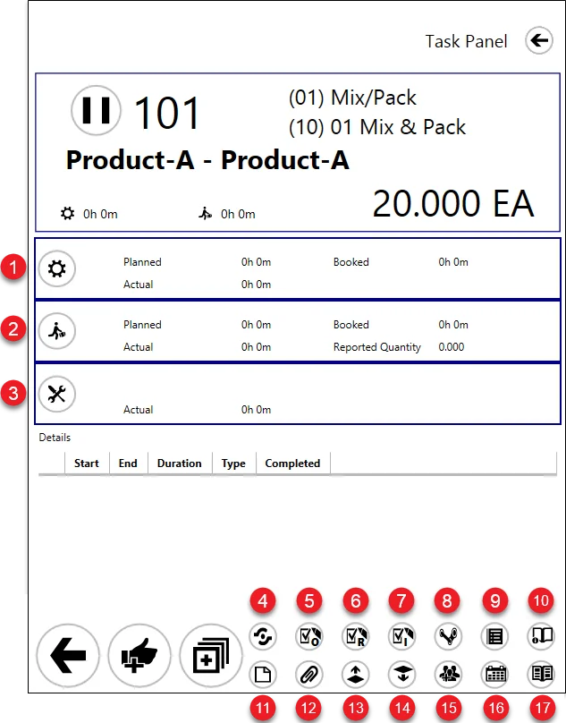
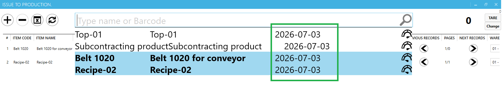
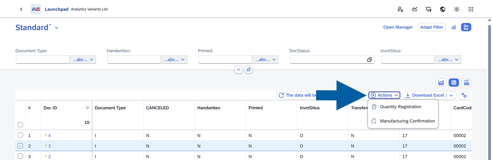
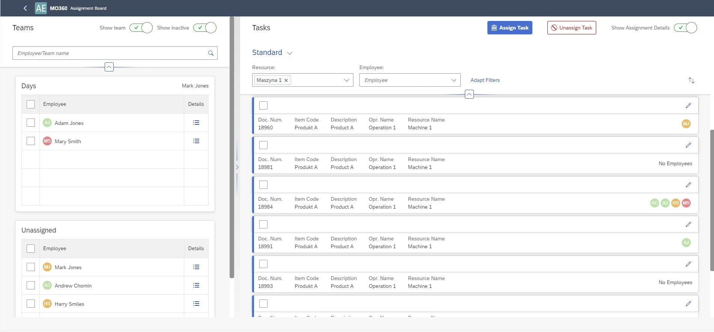
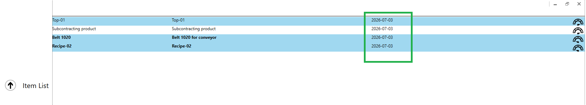
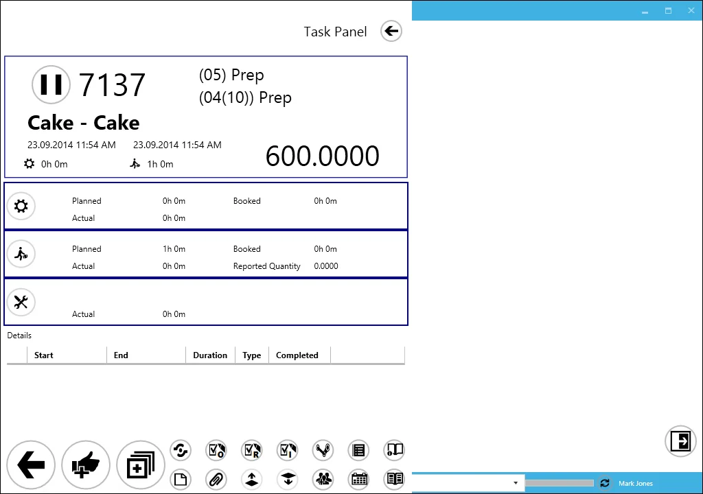
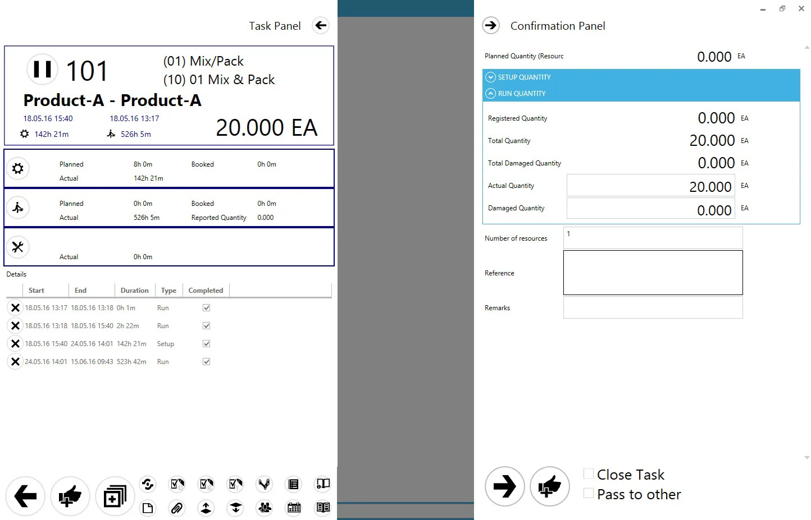
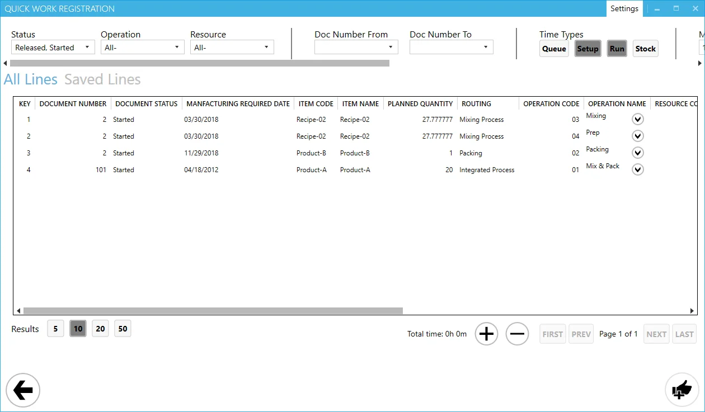

# CompuTec PDC: 3.10.18.2 versus 4.x

Reviewed **22 October 2026** for Contamac. Baseline is the user's confirmed **PDC 3.10.18.2**, **AppEngine 2.10.11.5**, and **ProcessForce 10.0.20.15 R20 HF2**. This is a documentation comparison, not a test of either installation.

## Release and interface summary

The latest publicly documented release found on the **live** vendor page is **PDC 4.2610.1**, released **7 October 2026**. Search-engine copies initially returned July/September releases; the live page and vendor-maintained documentation source contain the October entry. [PDC 4 release notes](https://learn.computec.one/docs/pdc/releases/pdc/), [vendor source](https://github.com/CompuTec/computec-docs/blob/main/docs/pdc/releases/pdc.md).

Separate three things when evaluating the appearance: the established PDC terminal application, the newer web registration workflow, and the separate MO360 Manufacturing Cockpit. A modern web screenshot of MO360 is not evidence that the entire PDC terminal has been replaced. The vendor describes the web plugin as complementing the main application. [PDC plugin guide](https://learn.computec.one/docs/pdc/pdc-plugin/computec-pdc-plugin/).

## Changes relevant to your installation

| Area | Difference to evaluate | Evidence |
| --- | --- | --- |
| Timer control | 4.2610.1: stop-task prompt on exit/logout/inactivity. | [4.x notes](https://learn.computec.one/docs/pdc/releases/pdc/) |
| Task ordering | 4.2610.1: tile sorting by planned dates and priority. | [4.x notes](https://learn.computec.one/docs/pdc/releases/pdc/) |
| Responsiveness | 4.2610.1: faster concurrent confirmations; duplicate Start/Stop dialogs fixed. | [4.x notes](https://learn.computec.one/docs/pdc/releases/pdc/) |
| Web booking | 4.2603.1: operation/resource time, quantity, inventory registration; SAP-menu access. | [4.x notes](https://learn.computec.one/docs/pdc/releases/pdc/) |
| QC | 4.2607.1: edit QC document/test statuses. | [4.x notes](https://learn.computec.one/docs/pdc/releases/pdc/) |
| Item information | 4.2506.1: configurable UDF display in selection/issue/receipt. | [4.x notes](https://learn.computec.one/docs/pdc/releases/pdc/), [UDF guide](https://learn.computec.one/docs/pdc/administrator-guide/setting-up-the-application/pdc-settings/display-udfs/) |
| Material handling | Batch scanning, issued-quantity and bin-display improvements. | [4.x notes](https://learn.computec.one/docs/pdc/releases/pdc/) |

These are vendor-recorded changes, not confirmation that the corresponding features are enabled for Contamac. They also do not establish that every improvement is exclusive to the 4.x branch.

## Improvements already introduced after your build in 3.x

Your version predates several useful changes that should not be attributed solely to PDC 4:

- **3.10.19.1:** issue/receipt from multiple warehouses at resource-tile level.
- **3.10.20.1:** additional custom-button/field space, indicators for available supporting information, and MOR/resource-line barcode handling.
- **3.10.21.1:** warning when starting another task on a resource that already has a running task.
- **3.10.25.3:** fix for duplicate labour tasks for one team leader.

These are introduction/fix milestones from the [PDC 3.x release history](https://learn.computec.one/docs/appengine/2.0/releases/plugins/pdc/release-notes/). Confirm their behavior in the proposed 4.x configuration during a demonstration. The duplicate-labour fix does not establish that every repeated resource booking has the same cause. Exact hotfix-specific notes for installed 3.10.18.2 were not found in the reviewed release history.

## Screenshots and what they establish

All images below are unmodified CompuTec illustrations downloaded on 22 October 2026. They show vendor sample data, not Contamac. None is asserted to be a verified capture of build 4.2610.1. Asset URLs and limitations are recorded in [the screenshot register](images/pdc-comparison/sources.json).

### 1. Established PDC task-panel layout

This illustrates the familiar task/operation/resource layout with setup, run, and downtime. It is a baseline reference, not a new 4.x screen or an exact screenshot of your installation. [Vendor task-panel guide](https://learn.computec.one/docs/pdc/user-guide/task-activities/overview/).

### 2. UDF information in the issue screen

The vendor's UDF guide shows additional item information within the existing terminal-style screen. For Contamac, evaluate which confirmed item fields would help operators identify materials. Content is configurable; this screenshot is not your configuration. [Vendor UDF guide](https://learn.computec.one/docs/pdc/administrator-guide/setting-up-the-application/pdc-settings/display-udfs/).

### 3. Web entry point for registration

This shows the current AppEngine web interface with **Quantity Registration** and **Manufacturing Confirmation** actions. It is an entry-point screenshot, not the opened PDC booking form. A verified public screenshot of that new form was not located. [Vendor Analytics Actions guide](https://learn.computec.one/docs/appengine/appengine-users-guide/analytical-page/analytics-actions/).

### 4. MO360 assignment board: separate companion plugin

This shows team/employee dispatching in the **MO360 Manufacturing Cockpit**. It is included because the current PDC product page uses it, but MO360 is a separate plugin; inclusion in your licenses and proposed solution is unconfirmed. This capability should not be assumed new or bundled with PDC 4. [MO360 overview](https://learn.computec.one/docs/pdc/manufacturing-order-360/overview/), [current PDC product page](https://www.computec.one/solutions/computec/pdc).

### Additional terminal illustrations: build unverified

Further terminal-only images were retrieved on 22 October 2026. None supplies a visible application build. The task and confirmation images contain historical sample dates; their presence in the current guide does not establish that they depict PDC 4.x. Fresh captures from a version-confirmed 4.x demonstration are still needed for a definitive visual comparison.

**Item selection with additional information**, from the [UDF guide linked in the 4.x release notes](https://learn.computec.one/docs/pdc/administrator-guide/setting-up-the-application/pdc-settings/display-udfs/):

**Task panel**, from the [task activities guide](https://learn.computec.one/docs/pdc/user-guide/task-activities/overview/):

**Confirmation panel**, from the [task activities guide](https://learn.computec.one/docs/pdc/user-guide/task-activities/overview/):

**Quick Work Registration**, from the [Quick Time Booking guide](https://learn.computec.one/docs/pdc/user-guide/task-activities/quick-time-booking/):

## Platform implications for Contamac

Weighing is a confirmed Contamac requirement. See the [weighing-specific evidence and screenshots](pdc-4-weighing.md): PDC 4.x explicitly documents weight capture, while complete migration of the established wizard/board remains unverified.

Your AppEngine 2.10.11.5 belongs to the older .NET Framework generation. PDC 4 documentation points to AppEngine 3.0. The vendor requires compatible CompuTec components to be updated together and describes migration to ProcessForce 3.0; plan this as a coordinated environment upgrade. Regular updates for **ProcessForce 2.0 and AppEngine 2.0 end on 31 December 2026**. [Migration and lifecycle guide](https://learn.computec.one/docs/processforce/administrator-guide/installation/update-to-ct-pf-30/).

The current AppEngine 3.0 requirements list **SAP B1 10.0 FP2408**, matching **64-bit DI API**, and **.NET/ASP.NET 8.0.13** as minimums. Your captured SAP identifier `1000201` has not been mapped to a named feature pack, so SAP compatibility is unconfirmed. AppEngine 3.0 does not support PowerShell customizations; determine whether you have any before migration. [System requirements](https://learn.computec.one/docs/appengine/administrators-guide/requirements/).

Also review WMS **2.10.20.10**, Labels **4.7.1.117**, AppEngine jobs, PDC profiles/custom views, printing, and integrations in the compatibility plan. Their exact target builds and any license changes were not established by this review.

## Suggested Contamac demonstration

These are evaluation recommendations, not vendor promises:

1. Reproduce a known FG MOR using the same operation/resource and distinct setup/run bookings; compare PDC activity with saved PF booking documents and costs.
2. Try starting another task on the same resource, rapid repeated Start/Stop clicks, logout with timers running, inactivity logout, and a shift handover.
3. Repeat with a team leader and multiple employees. Verify labour/machine entries separately; do not assume a second-task warning prevents every duplicate booking.
4. Demonstrate the opened web registration and confirmation forms, then terminal equivalents. Establish which workflow operators would actually use.
5. Test one bin-managed issue/receipt and one Labels print using copied company configuration; compare quantities, batch allocations, documents, and label counts.
6. Confirm the full SAP/PF/AppEngine/PDC/WMS/Labels version matrix, licensing, customization migration, and a test-company acceptance plan with the partner.

The most relevant potential benefits for your current investigation are timer control and clearer task handling. Whether they prevent your observed repeated bookings must be established with the real example above.
