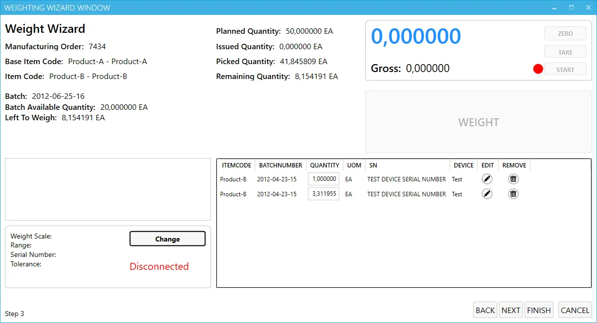
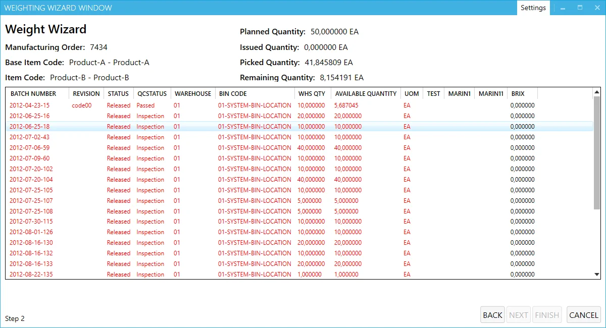
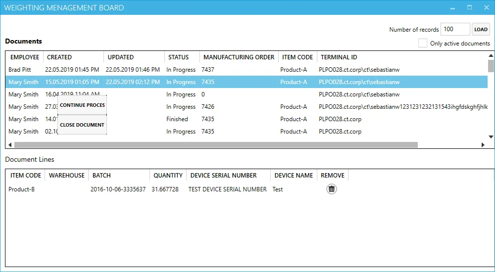

# PDC 4.x Weighing: Evidence and Screenshots

Reviewed **22 October 2026**. The user confirms Contamac uses weighing screens in the current environment, including PDC **3.10.18.2**. Exact scale models, drivers, and weighing settings have not been supplied.

## What is confirmed

**PDC 4.2605.2**, released **14 May 2026**, explicitly added weight capture control support in **Manufacturing Order Confirmation**. This establishes weighing capability in 4.x, but is not a feature-parity statement for the established Weighing Wizard. [PDC 4 release notes](https://learn.computec.one/docs/pdc/releases/pdc/).

The vendor continues to publish the [Weight Scale Module / Weighing Wizard guide](https://learn.computec.one/docs/pdc/user-guide/customization/optional-functions/weight-scale-module/overview/) and [Weight Management Board guide](https://learn.computec.one/docs/pdc/user-guide/customization/optional-functions/weight-scale-module/weight-management-board/). Neither identifies a 4.x build for its screenshots. Continued publication alone does not confirm complete migration to 4.x.

## Published screenshots: build unverified

These are unmodified vendor illustrations with historical sample data, not Contamac data or verified PDC 4.x captures. Original asset URLs and hashes are in the [screenshot register](images/pdc-comparison/sources.json).

**Weighing window:** scale readings and controls, material quantities, scale selection, and recorded measurements. [Wizard guide](https://learn.computec.one/docs/pdc/user-guide/customization/optional-functions/weight-scale-module/overview/).

**Batch selection:** material batches with warehouse/bin and available quantities. [Wizard guide](https://learn.computec.one/docs/pdc/user-guide/customization/optional-functions/weight-scale-module/overview/).

**Weight Management Board:** documents and lines, including continuing an unfinished process or closing a document. Access requires Management Board privileges. [Board guide](https://learn.computec.one/docs/pdc/user-guide/customization/optional-functions/weight-scale-module/weight-management-board/).

## Contamac upgrade acceptance question

Ask the partner to demonstrate the **existing end-to-end weighing workflow on a version-confirmed PDC 4.x terminal**, using your scale connection and copied configuration. Include zero/tare/net/gross capture, tolerance/precision rules, batch/bin selection, production posting, and resuming unfinished weighing documents through the board. Confirm Gateway and any custom scale-driver compatibility separately. [Scale integration documentation](https://learn.computec.one/docs/pdc/administrator-guide/weight-scales-integration/overview/).

The available evidence confirms some weighing support in PDC 4.x. Complete carry-over of Contamac's current workflow remains unverified.
